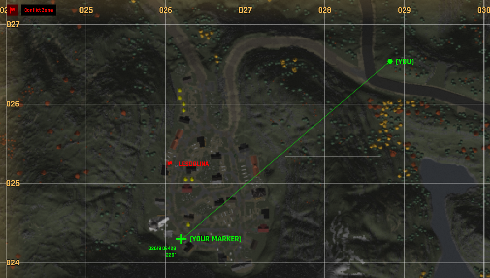
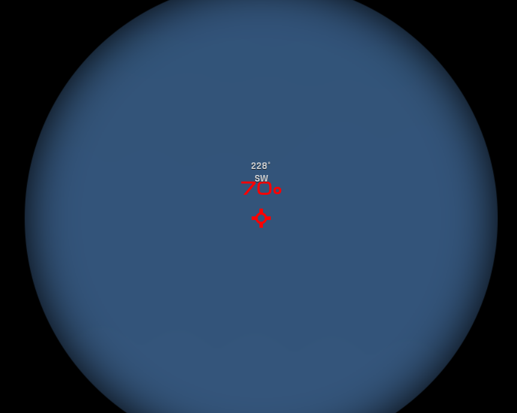

# M320A1 Indirect Fire Calculator

Use the M320A1 grenade launcher as a makeshift mortar. Enter your grid and the target grid. The page gives you the **distance**, the **bearing** and the **launch elevation** you need.

**Live page:** `https://<your-username>.github.io/<repo-name>/`

Maximum range is about **580 m at 45°**.



## How it works

| Step | Formula |
|---|---|
| Distance | `D = 10 · √((x₂ − x₁)² + (y₂ − y₁)²)` for 4-digit grids (each unit is 10 m) |
| Bearing | `B = atan2(x₂ − x₁, y₂ − y₁) mod 360` |
| Elevation | Find where `range(angle) = D` on the measured range curve. There are two answers, one below 45° and one above. |

Worked example (from the screenshots):

- You: `0288 0266` → Target: `0262 0243`
- Distance: **347 m**, bearing **228.5° (SW)**
- Elevation: **≈ 70°** high angle (or ≈ 17° low angle)

### Range table (flat ground, sight zeroed at 50 m)

| Elevation | 0° | 10° | 20° | 25° | 30° | 35° | 40° | 45° | 50° | 55° | 60° | 65° | 70° | 75° | 79° |
|---|---|---|---|---|---|---|---|---|---|---|---|---|---|---|---|
| Range (m) | 50 | 217 | 397 | 463 | 512 | 555 | 577 | 581 | 567 | 540 | 490 | 428 | 352 | 270 | 188 |

The calculator interpolates linearly between these points. To refine it, add measurements to the `TABLE` array at the top of the `<script>` in `index.html`.

## In-game use

1. Open the map with **navigation aid** on and read both grids (4 digits per axis).
2. Enter them in the calculator.
3. Face the bearing using your compass (`K`).
4. Use the **Cobra rangefinder** to read your vertical angle and tilt until it matches the elevation.
5. Fire. Spot the impact with RGE or a drone and correct.



## Deploying to GitHub Pages

1. Create a new public repository, for example `m320-mortar`.
2. Upload everything in this folder (`index.html`, `README.md`, `.nojekyll`, `assets/`) to the root of the `main` branch.
3. Go to **Settings → Pages**. Under **Build and deployment**, set Source to **Deploy from a branch**, then pick `main` / `/ (root)` and save.
4. After a minute the site is live at `https://<your-username>.github.io/m320-mortar/`.

From the command line:

```bash
cd m320-mortar
git init -b main
git add .
git commit -m "M320A1 indirect fire calculator"
git remote add origin https://github.com/<your-username>/m320-mortar.git
git push -u origin main
```

## Roadmap

- [ ] Height difference between shooter and target
- [ ] More range-table points (above 79°, and between 0° and 10°)
- [ ] Support for other launchers and rounds

## Credits

Method and original [Desmos calculator](https://www.desmos.com/calculator/yixjogvpyl) by the community post this page is based on. If someone has already built something similar, open an issue and link it!
